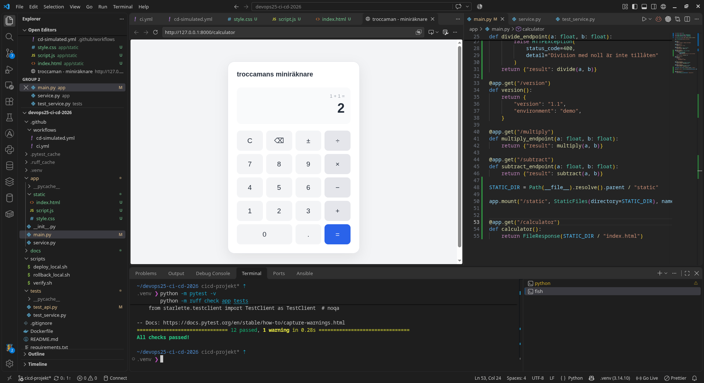
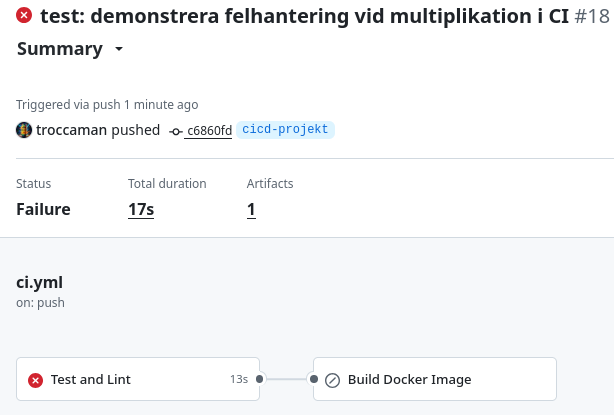
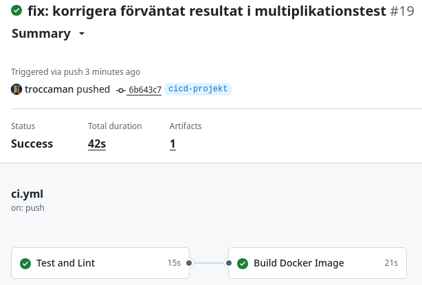
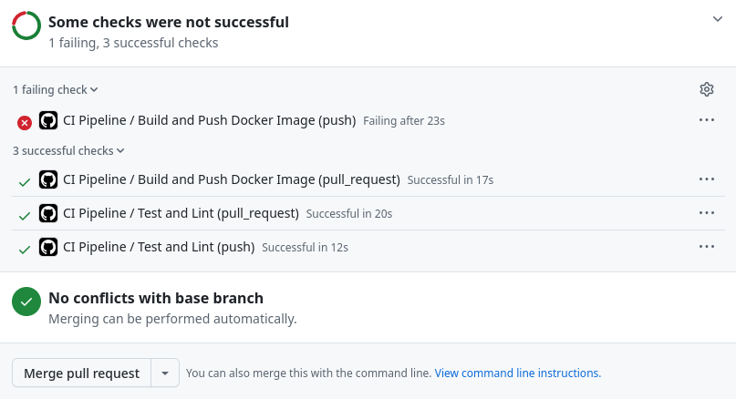
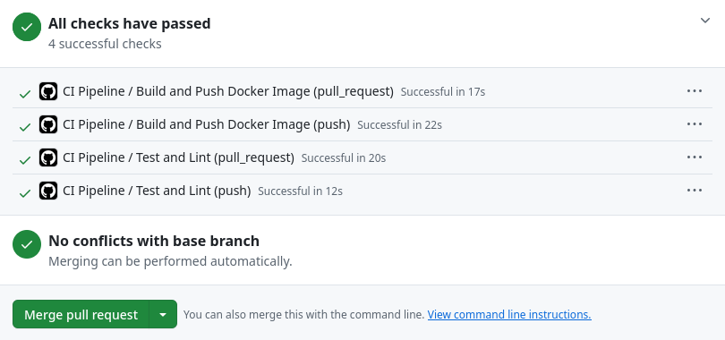
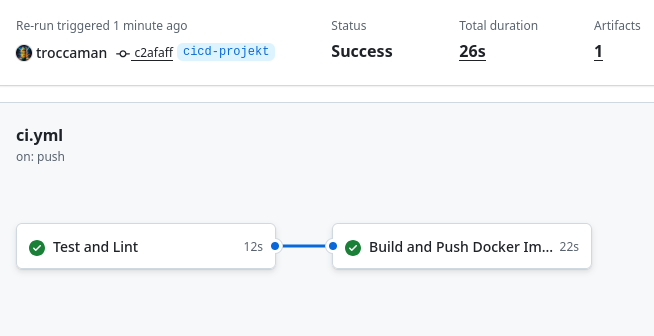
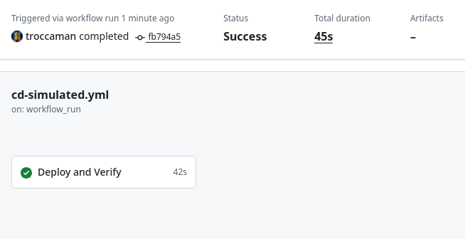
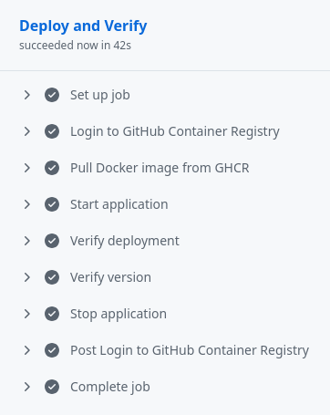
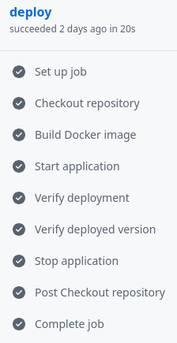

# CI/CD-projekt – FastAPI-miniräknare

Ett projekt från DevOps Engineer-utbildningen på Nackademin. En FastAPI-applikation har byggts ut med en miniräknare i HTML, CSS och JavaScript. Projektet visar hur tester, Docker-byggnation och simulerad deployment automatiseras med GitHub Actions och GitHub Container Registry (GHCR).

**Status:** CI och CD är nu kopplade till varandra. En godkänd CI-körning publicerar en Docker-image i GHCR, som CD sedan hämtar och verifierar. Applikationen körs tillfälligt i GitHub Actions, inte på en produktionsserver.

## Projektets utveckling

Projektet började som en FastAPI-applikation med automatiserad testning i GitHub Actions. Ett avsiktligt testfel användes för att demonstrera hur en misslyckad CI-körning stoppar Docker-bygget.

Därefter implementerades en separat, simulerad CD-process samt Bash-skript för lokal deployment, verifiering och rollback. En återställning från applikationsversion 1.2 till 1.1 genomfördes med Docker.

Projektet vidareutvecklades sedan med en webbaserad miniräknare i HTML, CSS och JavaScript, utökade API-funktioner och totalt 12 automatiserade tester.

Slutligen kopplades CI och CD samman. Docker-imagen publiceras nu i GitHub Container Registry (GHCR), och CD startar först efter en godkänd CI-körning och hämtar samma image för verifiering.

## Tekniker och verktyg

| Teknik | Användning |
| --- | --- |
| Python / FastAPI | API och beräkningslogik |
| HTML / CSS / JavaScript | Miniräknarens gränssnitt |
| Pytest / Ruff | Tester och kodkontroll |
| Docker / GHCR | Containerbygge och lagring av images |
| GitHub Actions | CI och simulerad CD |
| Bash | Lokal deployment, verifiering och rollback |

## Projektstruktur

```text
devops25-ci-cd-2026/
├── .github/
│   └── workflows/
│       ├── ci.yml
│       └── cd-simulated.yml
├── app/
│   ├── __init__.py
│   ├── main.py
│   ├── service.py
│   └── static/
│       ├── index.html
│       ├── style.css
│       └── script.js
├── tests/
│   ├── test_api.py
│   └── test_service.py
├── scripts/
│   ├── deploy_local.sh
│   ├── verify.sh
│   └── rollback_local.sh
├── docs/
│   └── screenshots/
│       ├── 01-ci-failed.png
│       ├── 02-ci-success.png
│       ├── 03-cd-success.png
│       ├── 04-cd-success-verify.png
│       ├── 05-calculator.png
│       ├── 06-ghcr-push-failed.png
│       ├── 07-ghcr-push-success1.png
│       ├── 08-ghcr-push-success2.png
│       ├── 09-cd-ghcr-success.png
│       └── 10-cd-verification-steps.png
├── Dockerfile
├── requirements.txt
├── .gitignore
└── README.md
```

- **`app/`** innehåller FastAPI, beräkningslogik och miniräknarens frontend.
- **`tests/`** innehåller automatiserade tester; **`.github/workflows/`** innehåller CI och CD.
- **`scripts/`** används för lokal deployment och rollback; **`docs/screenshots/`** visar test- och körresultat.

## Applikationen

`app/main.py` hanterar API-anrop och serverar webbsidan, medan `app/service.py` utför beräkningarna. Frontend-filerna ligger i `app/static/` och anropar API:et med JavaScript.

| Adress | Funktion |
| --- | --- |
| `/calculator` | Miniräknaren |
| `/add`, `/subtract`, `/multiply`, `/divide` | Fyra räknesätt med parametrarna `a` och `b` |
| `/health` | Kontrollerar att API:et svarar |
| `/version` | Returnerar version `1.1` |

Division med noll ger HTTP 400. Saknade obligatoriska parametrar ger HTTP 422.

Starta lokalt från projektmappen:

```bash
python -m pip install -r requirements.txt
python -m uvicorn app.main:app --reload
```

Öppna [http://127.0.0.1:8000/calculator](http://127.0.0.1:8000/calculator).



## Tester och CI

Testerna kontrollerar bland annat beräkningar, API-svar, felhantering och att HTML-sidan levereras. De körs tillsammans med Ruff:

```bash
python -m pytest -v
python -m ruff check app tests
```

**Senaste lokala resultat:** `12 passed, 1 warning` och `All checks passed!`. HTML-testet kontrollerar att sidan levereras, men testar inte knapptryckningar i en riktig webbläsare.

CI-flödet finns i `.github/workflows/ci.yml`:

```text
Push / Pull Request
        ↓
  Pytest + Ruff
        ↓ godkänt
  Docker build
        ↓ vid push
  Publicera i GHCR
```

Docker-jobbet använder `needs: test-and-lint` och hoppas över om testerna misslyckas. Testresultaten sparas i `test-results.xml` som en artifact, även om testerna inte blir godkända. Docker-imagen taggas med commit-SHA för spårbarhet. Vid Pull Request byggs imagen men publiceras inte.

### Demonstration: röd och grön CI

Multiplikationstestet fick avsiktligt förvänta sig `999` i stället för `20`. Ett test misslyckades och Docker-bygget hoppades över. Efter korrigering blev pipelinen grön. Felet låg i testets förväntade svar, inte i beräkningsfunktionen.

| Misslyckad CI | Godkänd CI |
| --- | --- |
|  |  |

## GHCR – från behörighetsfel till lyckad publicering

Vid första försöket lyckades Docker-bygget, men publiceringen till GHCR nekades med `error from registry: denied`. Inställningen under **Settings → Actions → General → Workflow permissions** ändrades till **Read and write permissions**. Efter en omkörning lyckades publiceringen. Behörighetsändringen var den sannolika lösningen.

| Före: nekad publicering | Efter: lyckad publicering |
| --- | --- |
|  |  |



## CD – beroende av godkänd CI

CD-flödet ligger i `.github/workflows/cd-simulated.yml`. Det använder `workflow_run` och kör deployment-jobbet **endast efter en lyckad CI-körning som startats av en push**.

```text
CI godkänd → Docker-image i GHCR
                  ↓
        CD hämtar samma image
                  ↓
           Startar container
                  ↓
       Kontrollerar /health
          och /version
                  ↓
         Tar bort containern
```

CD hämtar imagen med den utlösande CI-körningens commit-SHA i stället för att bygga en egen. Efter merge av Pull Request **#4** på `main` lyckades hela flödet: inloggning i GHCR, image-hämtning, containerstart, hälsokontroll, versionskontroll och borttagning av containern.

| Lyckad CD-körning | Alla verifieringssteg |
| --- | --- |
|  |  |

### Tidigare fristående CD

Innan flödena kopplades samman byggde CD en egen Docker-image vid push. Dessa bilder visar den tidigare lösningen:

| Tidigare CD-körning | Tidigare verifiering |
| --- | --- |
|  |  |

## Lokal deployment och rollback

Tre Bash-skript används separat från GitHub Actions-CD:

| Skript | Funktion |
| --- | --- |
| `scripts/deploy_local.sh` | Bygger en lokal Docker-image och startar en container |
| `scripts/verify.sh` | Kontrollerar `/health` med upprepade försök |
| `scripts/rollback_local.sh` | Startar tidigare lokala imagen `cicd-projekt:v1` och verifierar den |

```bash
bash scripts/deploy_local.sh
bash scripts/verify.sh
```

Rollback demonstrerades genom att köra en container från `cicd-projekt:v2` (applikationsversion 1.2) och sedan återgå till `cicd-projekt:v1` (version 1.1). Den tillfälliga ändringen till version 1.2 committades inte.

Skripten behöver inte ändras för den nya CI/CD-kedjan: de är avsedda för lokal användning och hämtar inte images från GHCR.

## Begränsningar och nästa steg

CD är fortfarande **simulerad** och kör ingen permanent deployment. Versionskontrollen förväntar sig `1.1`, och automatisk rollback saknas. En vidareutveckling kan vara deployment till en egen server, automatisk rollback, dynamisk versionshantering och webbläsartester för miniräknaren.

Projektet visar därmed hela vägen från kodändring och tester till versionsmärkt Docker-image, GHCR och verifierad simulerad CD – samt hur fel upptäcks och felsöks längs vägen.
