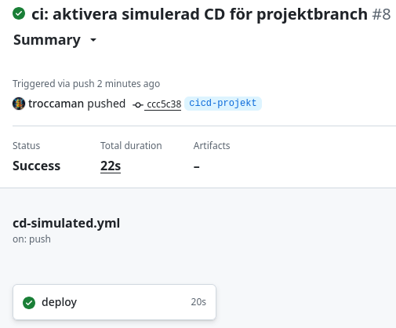

# CI/CD-projekt – automatiserad testning och deployment

Praktiskt projekt inom automatiserad testning, Continuous Integration och Continuous Delivery, utvecklat under **DevOps Engineer-utbildningen på Nackademin**.

Projektet bygger vidare på tidigare CI/CD-laborationer och omfattar automatiserade tester med Pytest, kodkontroll med Ruff och Docker-byggnation via GitHub Actions. Arbetet demonstrerar även felsökning av en misslyckad pipeline, simulerad deployment samt versionshantering och rollback med Docker och Bash.

## 1. Projektöversikt

Detta projekt bygger vidare på kursens FastAPI-applikation och demonstrerar ett CI/CD-flöde med GitHub Actions, Pytest, Ruff, Docker och Bash. Målet är att automatisera kontroller, fånga upp fel innan Docker-bygget och verifiera att en levererad applikation fungerar.

I projektet har jag:

- Utökat API:et med multiplikation och test av saknad parameter.
- Skapat ett avsiktligt fel i ett test och visat hur CI stoppar Docker-bygget.
- Korrigerat testet och verifierat en grön CI-körning.
- Använt simulerad CD för att bygga, starta och kontrollera applikationen.
- Anpassat Bash-skript för lokal deployment och rollback.
- Demonstrerat återställning från applikationsversion 1.2 till 1.1.

Projektet är en utbildningsmiljö, inte en produktionsdriftsättning.

## 2. Tekniker och verktyg

| Teknik | Användning |
| --- | --- |
| Python och FastAPI | Applikation och REST API |
| Pytest | Funktionella tester och API-tester |
| Ruff | Automatisk kodkontroll |
| Git och GitHub | Versionshantering, brancher och Pull Requests |
| GitHub Actions | CI och simulerad CD |
| Docker | Bygga images och köra containrar |
| Bash | Lokal deployment, verifiering och rollback |
| Linux | Lokal utvecklings- och testmiljö |

GitHub Actions och Docker-imagen använder Python 3.12. Lokalt har testerna även körts i en Python 3.14-miljö.

## 3. Projektstruktur

```text
devops25-ci-cd-2026/
├── .github/
│   └── workflows/
│       ├── ci.yml
│       └── cd-simulated.yml
├── app/
│   ├── __init__.py
│   ├── main.py
│   └── service.py
├── tests/
│   ├── test_api.py
│   └── test_service.py
├── scripts/
│   ├── deploy_local.sh
│   ├── verify.sh
│   └── rollback_local.sh
├── docs/
│   └── screenshots/
│       ├── 01-ci-failed.png
│       ├── 02-ci-success.png
│       ├── 03-cd-success.png
│       └── 04-cd-success-verify.png
├── Dockerfile
├── requirements.txt
├── .gitignore
└── README.md
```

## 4. Applikation och ny funktionalitet

API:et har följande endpoints:

| Endpoint | Syfte |
| --- | --- |
| `/` | Grundläggande meddelande |
| `/health` | Kontrollerar att applikationen svarar |
| `/version` | Visar version och miljö |
| `/add?a=2&b=3` | Addition |
| `/multiply?a=4&b=5` | Multiplikation |

Den nya multiplikationsfunktionen ligger i `app/service.py`:

```python
def multiply(a: float, b: float) -> float:
    return a * b
```

Den anropas via en endpoint i `app/main.py`:

```python
@app.get("/multiply")
def multiply_endpoint(a: float, b: float):
    return {"result": multiply(a, b)}
```

**Varför?** Beräkningslogik och API hålls åtskilda så att koden blir enklare att förstå och testa. Jag lade även till ett test som bekräftar att FastAPI avvisar ett anrop till `/add` när en obligatorisk parameter saknas (HTTP 422).

## 5. Automatiserad testning

Tester finns i `tests/test_api.py` och `tests/test_service.py`.

| Test | Vad som kontrolleras |
| --- | --- |
| `test_health` | `/health` ger HTTP 200 och rätt JSON |
| `test_add_endpoint` | Addition genom API:et |
| `test_version` | API:et returnerar version 1.1 |
| `test_add_missing_parameter` | Saknad parameter ger HTTP 422 |
| `test_multiply_endpoint` | Multiplikation genom API:et |
| `test_add` | Additionsfunktionen direkt |
| `test_divide` | Divisionsfunktionen direkt |
| `test_divide_by_zero` | Division med noll ger `ValueError` |

Lokala kontroller:

```bash
python -m pytest -v
python -m ruff check app tests
```

Verifierat resultat:

```text
8 passed, 1 warning
All checks passed!
```

Varningen hindrade inte testerna från att bli godkända.

## 6. Continuous Integration – CI

Workflowen finns i `.github/workflows/ci.yml` och körs vid push till `main`, `demo/**` och `cicd-projekt`, samt vid Pull Request mot `main`.

```text
Push / Pull Request
        |
        v
Installera beroenden
        |
        v
Pytest + testrapport (artifact)
        |
        v
Ruff
        |
        v
Test and Lint godkänt?
      /       \
    Nej       Ja
     |         |
     v         v
Docker-build  Docker-build
hoppas över   körs
```

Det separata Docker-jobbet använder `needs: test-and-lint`. Därför körs det inte om test- eller lintkontrollerna misslyckas. Docker-imagen taggas med Git-commitens SHA för spårbarhet, men publiceras inte i ett registry.

Pytest skriver resultat till `test-results.xml`. Filen sparas som en GitHub Actions-artifact med `if: always()`, även vid misslyckade tester.

## 7. Kontrollerat testfel – röd till grön CI

För att demonstrera felhantering fick multiplikationstestet avsiktligt förvänta sig `999` fast `4 × 5` ger `20.0`.

**Misslyckad körning:** Sju tester godkändes och ett misslyckades. `Test and Lint` blev rött och `Build Docker Image` hoppades över. Testrapporten sparades som artifact.


**Korrigerad körning:** Testets förväntade resultat ändrades till `20.0`. Efter en ny commit och push godkändes samtliga åtta tester, Ruff och Docker-bygget.


**Lärdom:** CI ska inte alltid vara grön. Den ska kunna stoppa en ändring som inte uppfyller kontrollerna. I detta fall fanns felet i testets förväntade resultat, inte i multiplikationsfunktionen.

## 8. Simulerad Continuous Delivery – CD

Workflowen i `.github/workflows/cd-simulated.yml` bygger en Docker-image på en tillfällig GitHub-runner, startar en container, verifierar den och tar bort containern efteråt.

```text
Push till konfigurerad branch
            |
            v
      Docker-build
            |
            v
     Starta container
            |
            v
     Kontrollera /health
            |
            v
     Kontrollera /version
            |
            v
      Stoppa container
```

Förväntade API-svar:

```json
{"status":"ok"}
```

```json
{"version":"1.1","environment":"demo"}
```




CI och CD startar separat vid samma push. I den nuvarande lösningen väntar CD inte automatiskt på ett godkänt CI-jobb. Det är en medvetet redovisad begränsning, och ingen driftsättning görs till en permanent produktionsserver.

## 9. Lokal deployment – varför Bash-skript?

Jag använde först Docker-kommandon manuellt för att förstå image, container, portar och versionsbyte. Därefter använde jag de befintliga Bash-skripten, anpassade till projektets namn, för att förenkla de återkommande momenten.

| Skript | Vad det automatiserar | Nytta |
| --- | --- | --- |
| `deploy_local.sh` | `docker build`, borttagning av gammal container och `docker run` | Repeterbar lokal deployment |
| `verify.sh` | Flera försök med `curl` mot `/health` | Tydlig hälsokontroll |
| `rollback_local.sh` | Kontroll av v1-image och start av v1-container | Enklare återställning |

Lokal deployment och verifiering:

```bash
bash scripts/deploy_local.sh
bash scripts/verify.sh
```

Verifierat terminalresultat:

```text
=== Verifying deployment ===
{"status":"ok"}
Deployment verified successfully
```

Versionskontroll:

```bash
curl http://localhost:8000/version
# {"version":"1.1","environment":"demo"}
```

**Varför skript?** Samma kommandon körs i samma ordning, vilket sparar tid och minskar risken för manuella misstag. Skripten är versionshanterade i Git och kan återanvändas. `deploy_local.sh` verifierar dock inte själv applikationen; därför körs `verify.sh` separat.

## 10. Docker-versionering och rollback

Jag skapade två lokala Docker-images med olika applikationsversioner:

| Image | Svar från `/version` |
| --- | --- |
| `cicd-projekt:v1` | `1.1` |
| `cicd-projekt:v2` | `1.2` |

Version 2 byggdes med en tillfällig lokal versionsändring som inte committades.

Verifiering av **v2**:

```bash
sudo docker inspect --format '{{.Config.Image}}' cicd-projekt
# cicd-projekt:v2

curl http://localhost:8000/version
# {"version":"1.2","environment":"demo"}
```

Rollback:

```bash
bash scripts/rollback_local.sh
```

Verifiering efter rollback:

```bash
sudo docker inspect --format '{{.Config.Image}}' cicd-projekt
# cicd-projekt:v1

curl http://localhost:8000/version
# {"version":"1.1","environment":"demo"}

curl http://localhost:8000/health
# {"status":"ok"}
```

**Resultat:** Den körande containern återställdes från v2 till v1. Detta är ett versionsbyte, inte enbart en omstart. Efter demonstrationen återställdes källkodens versionsnummer till 1.1.

## 11. Begränsningar och möjliga förbättringar

- **CI och CD är inte beroendekopplade.** CD bör i en mer avancerad lösning vänta på en godkänd CI-körning.
- **Images publiceras inte.** För återställning mellan servrar behövs ett registry med spårbart versionsmärkta images.
- **Rollback är lokal.** Skriptet förutsätter att `cicd-projekt:v1` redan finns och hanterar inte databaser eller annan beständig data.
- **Kort driftavbrott uppstår.** Den gamla containern tas bort innan nästa startar.
- **Versionskontrollen är hårdkodad.** CD förväntar sig version 1.1; ett framtida förbättringssteg är en gemensam versionskälla.
- **Ingen automatisk återställning vid misslyckad deploy.** Detta skulle kunna införas vid vidareutveckling.

Dessa begränsningar är accepterade för kursprojektets omfattning.

## 12. Slutsats och lärdomar

Projektet visar hur Git, automatiska tester, Docker och GitHub Actions samverkar i ett praktiskt CI/CD-flöde.

Jag har framför allt lärt mig att:

- Skilja mellan kodkontroll, Docker-byggnation och verifierad deployment.
- Använda beroenden mellan CI-jobb för att stoppa byggnation när tester misslyckas.
- Spara testrapporter för spårbarhet och felsökning.
- Kontrollera både applikationens hälsa och rätt version.
- Automatisera upprepade Docker-kommandon med Bash.
- Återställa en tidigare körbar version genom rollback.

**Slutresultat:** En fungerande demonstration av CI, simulerad CD, lokal deployment och rollback – med ett dokumenterat testfel som stoppades och korrigerades.
